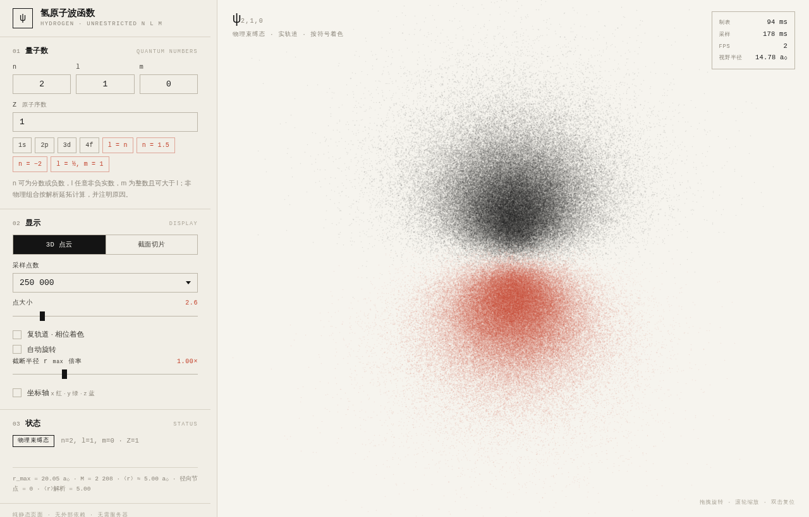

# 氢原子波函数可视化（量子数不设物理约束）

纯静态、零依赖的氢原子波函数可视化器。原生 WebGL2 + 经典 `<script>`，不需要构建、不需要服务器、不发起任何网络请求——双击 `index.html` 即可运行。

常规工具把 `n ≥ 1`、`0 ≤ l ≤ n−1`、`|m| ≤ l` 写死在输入控件里；本工具把这些约束打开：**n 可为分数或负数，l 可为任意非负实数，m 为整数且允许 |m| > l**，并通过截断归一化把非物理解画出来，同时在界面上逐条说明它为什么非物理。

在线访问：[quantum.stickerbug.top](quantum.stickerbug.top)


## 运行与部署

```bash
# 方式 1：直接打开
open index.html            # macOS
xdg-open index.html        # Linux

# 方式 2：任意静态服务器（可选）
python3 -m http.server 8000
# 然后访问 http://localhost:8000
```

部署：把 `index.html`、`css/`、`js/` 原样上传到任何静态托管（GitHub Pages、Netlify、nginx、对象存储、CDN）即可，无需构建步骤与环境变量。

浏览器要求：支持 WebGL2 的现代浏览器（Chrome / Edge / Firefox / Safari 15+）。

## 功能

- **3D 点云**：按 |ψ|² 做重要性采样，点数 10 万 – 100 万可选；实轨道按波函数符号着色（正墨、负朱），复轨道按相位着色。
- **x–z 截面切片**：对数密度色图，分辨率 512²，切片位置 y 与色阶动态范围可调。
- **任意量子数**：n、l、m、Z 直接输入；预置 1s/2p/3d/4f 以及若干非物理示例（`l = n`、`n = 1.5`、`n = −2`、`l = ½, m = 1`）。
- **实时反馈**：状态卡显示「物理 / 非物理 + 具体原因 + 警告」，并给出 r_max、径向网格数、⟨r⟩ 与径向节点数。
- **相机**：拖拽旋转、滚轮/双指缩放、双击复位；自动旋转可开关；切换量子数时自动按 95% 概率半径取景。
- **兼容渲染**：WebGL2 不可用或渲染上下文丢失时，自动切到 Canvas2D 软件渲染（较慢但不会白屏）；也可用 `?force2d=1` 强制启用。
- **深度线索**：点精灵默认半径 2.6 px，远端点自动缩小并降低不透明度（近处墨色更重），减少「后点糊到前点」的歧义；点大小滑杆可调到 0.6 px。
- **统计**：制表耗时、采样耗时、FPS、当前视野半径（Bohr）。

## 非物理量子数是怎么算的

径向部分用标准库默尔（Kummer）展开：

```
R_nl(r) ∝ (2r/n)^l · e^(−r/n) · ₁F₁(l+1−n; 2l+2; 2r/n)
```

对物理束缚态（n 正整数、l ≤ n−1、l 为非负整数），第一参数 `l+1−n` 是非正整数，级数自动截断成多项式，`R ~ e^(−r/n)` 可归一。除此之外的取值，级数不会截断，渐近行为是 `R ~ e^(+r/n)`，平方不可积——这正是它们「非物理」的根源。

本工具的处理方式：

| 输入 | 数学事实 | 显示方式 |
| --- | --- | --- |
| n 非整数 | 级数不截断，R 在 r→∞ 指数增长 | 按 [0, r_max] 截断归一后显示，状态卡说明 |
| l ≥ n（整数） | 离心项阻止截断，R ~ e^(r/n) 发散 | 同上 |
| n < 0 | 能量同 \|n\|，但取到指数增长的那支解 | 同上 |
| \|m\| > l 且 l 为整数 | P_l^m ≡ 0，角向恒为零 | 提示「没有可显示的密度」 |
| l 非整数 | Y_lm 不是球面单值函数；P_ν^m 在 θ→π 对数发散 | 按连带 Legendre 解析延拓计算，x 截断在 −0.995，状态卡警告 |
| m 非整数 | e^(imφ) 非单值 | 拒绝输入并说明原因 |

实现细节：

- **多项式分支用 Laguerre 三项递推**：`a = l+1−n` 为非正整数时，`₁F₁` 退化成次数 `k = n−l−1` 的多项式。此时改用 `L_k^{2l+1}(x)` 的前向三项递推 `(j+1)L_{j+1} = (2j+1+α−x)L_j − (j+α)L_{j−1}`（整体重缩放）。原来的 Kummer 级数在这个区域会发生灾难性抵消：例如 n=36、x≈33 时最大项约 9×10¹⁷，而真值只有约 50，双精度无法分辨，会凭空生成内层壳层。递推结果与 50 位 mpmath 对照，在整段 r 上只差一个常数因子（log 差恒定到 0.006）。
- **₁F₁ 带重缩放求和（非多项式态）**：每步若 |term| 或 |sum| 超过 1e100 就整体除以 1e100 并累加对数尺度，最终返回 `{logAbs, sign}`。这样 `n=1.5`、`l=30` 这类指数发散不会溢出成 `Infinity/NaN`；但这类态的数值精度只够定性观察，状态卡会标注「解析延拓」。
- **截断归一化**：在 `r ∈ [0, r_max]` 上对 `r²|R|²` 归一。非物理态的质量会堆积在 `r_max` 附近（这是发散的诚实表现），不是数值错误。
- **r_max 自动选取**：物理态先探到 `14·(n/Z)²`，再截到峰值下降 9 个 e 折处（约 `2.4·(n/Z)²`）；非物理态用 `4.2|n| + 1.4l(l+1) + 8`（上限 700 a₀），可用滑块乘 0.25–3 倍。
- **⟨r⟩**：由径向表数值积分得到；物理态同时给出解析值 `(3n² − l(l+1))/(2Z)` 供对照。

## 性能设计

目标：改参数后立刻出图，交互不卡顿。

1. **零依赖、单次 draw call**：不使用 Three.js/CDN；所有采样点放在一个 `Float32Array` 里，用实例化四边形（`drawArraysInstanced`，4 顶点/点）一次画完。用四边形而不是 `gl.POINTS`，是为了绕开 64 px 的点尺寸上限，并避开部分驱动/软件光栅器对 point sprite 的兼容性问题。
2. **逆 CDF 采样，O(1)/点**：径向、角向、φ 各自预计算 CDF 与反函数查表，不用拒绝采样。
3. **采样期零三角函数**：sin/cos 查表（8192 项）、sinθ 在角向表中预存、φ 表的 cos/sin 一并预存；RNG 为内联 xorshift32。300k 点约 25 ms（现代桌面 CPU）。
4. **分块渐进上传**：每帧采样 6 万点并 `bufferSubData`，首帧即有图像，长采样不阻塞 UI。
5. **切片用 LUT**：径向/角向/列方向 φ 因子全部预计算，逐像素只做两次插值，避免 `atan2`、`log`、`cos`。
6. **只在需要时重绘**：关闭自动旋转且无交互时完全空闲；DPR 上限 2；关闭深度测试与抗锯齿。
7. **表构建**：径向 `M = clamp(2048 + 80|n|, 2048, 12000)`（r 网格在原点附近平方加密），角向 `K = clamp(512 + 16l, 1024, 4096)`，φ 表 `K = clamp(512 + 32|m|, 512, 4096)`。

## 界面

界面结构参考 [VoltAgent/awesome-design-md](https://github.com/VoltAgent/awesome-design-md) 中 `vercel` 的 DESIGN.md：纸/墨单色体系、1px 发丝线、等宽技术标签、极性反转的选中态。按本次要求强制：0 圆角、无渐变、无阴影、无毛玻璃、无蓝紫（数据用墨黑与朱红，相位用朱/赭/橄榄/深绿四段），滑杆为 1px 轨道 + 方形滑块，所有表单控件均为自绘，不依赖浏览器默认外观。

## 文件结构

```
index.html          页面骨架 + 控件
css/app.css         扁平纸感 UI（无圆角/渐变/阴影）、响应式（窄屏为底部抽屉）
js/special.js       lgamma、gammaLogSign、带重缩放的 kummerLog、hyp2f1、连带 Legendre
js/atom.js          classify / chooseRange / computeRadial / computeAngular / computePhi
                    / createSampler / buildSlice（UMD 导出，可在 Node 里测试）
js/renderer.js      原生 WebGL2 渲染器：实例化四边形点云、切片四边形、坐标轴、mat4 相机
js/renderer2d.js    Canvas2D 兜底渲染器（同一套 API，软件 splat + 色调映射）
js/app.js           状态、控件、去抖重建、分块采样、相机交互、统计
```

`js/special.js` 与 `js/atom.js` 同时支持 `module.exports`，方便做数值验证：

```bash
node -e 'const A=require("./js/atom.js"); console.log(A.classify(2,2,0))'
```

## 开发参数

页面支持几个仅用于调试的 URL 参数：

```
index.html?force2d=1                 强制 Canvas2D 渲染
index.html?points=50000&size=5       覆盖采样点数/点大小
index.html?n=1.5&l=0&m=0             直接打开某个态
index.html?mode=slice&complex=1      切片模式 / 复轨道相位着色
index.html?rotate=0                  关闭自动旋转（截图用）
```

## 已知限制

- `|n| ≤ 300`、`l ≤ 400`、`|m| ≤ 400` 是渲染/数值上限（节点数、递推长度），与物理无关；超出会在状态卡说明。
- 非整数 l 的角向计算在 θ→π 附近做了截断（对数发散，无法在有限网格上表示），属于形式延拓而非严格球面函数。
- 单精度点云在 100 万点时，靠近原点的细节可能受浮点精度影响；调低点数或放大观察即可。
- 移动端 100 万点可能受 GPU 填充率限制，建议 25 万点。

## 许可

代码可自由使用与修改。
